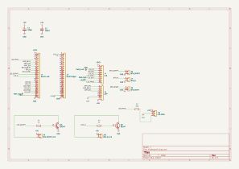
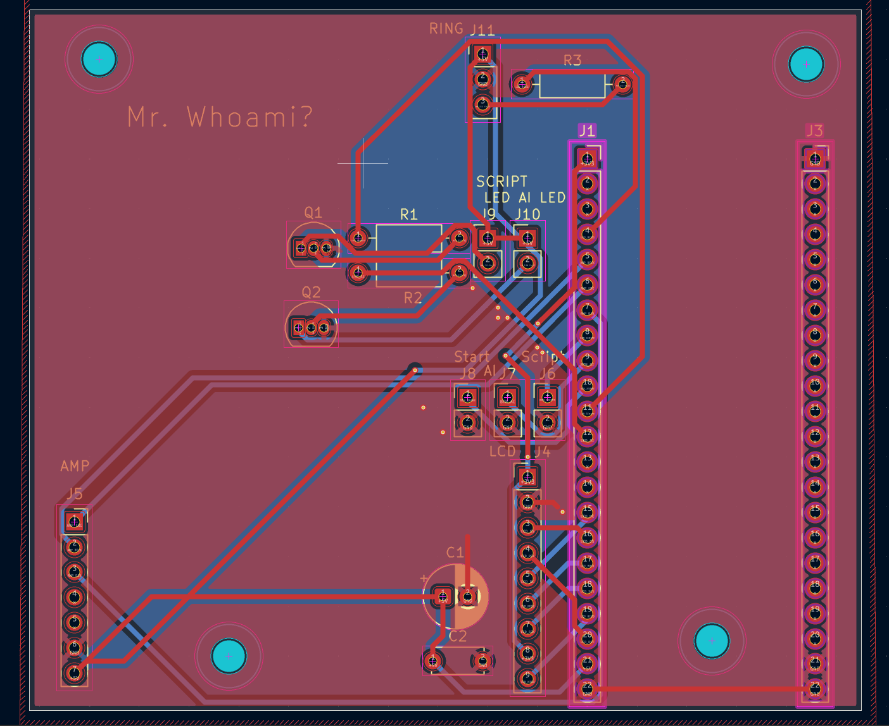
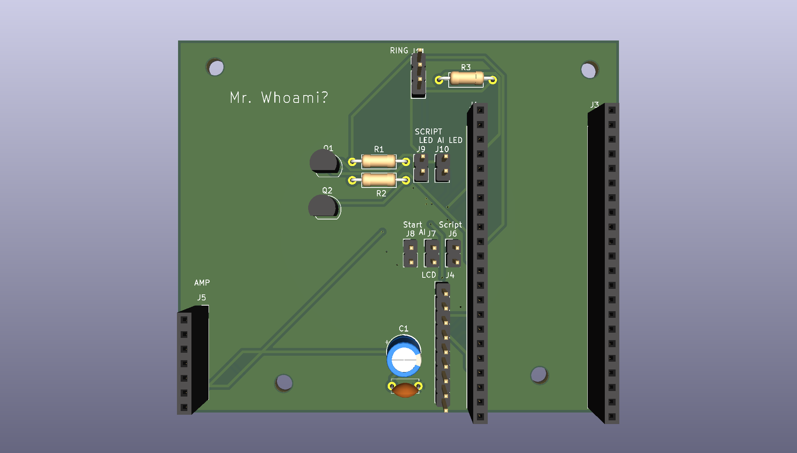
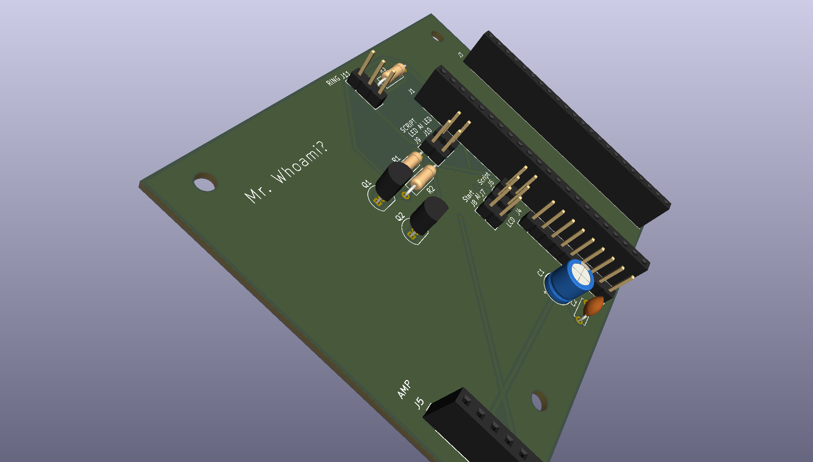
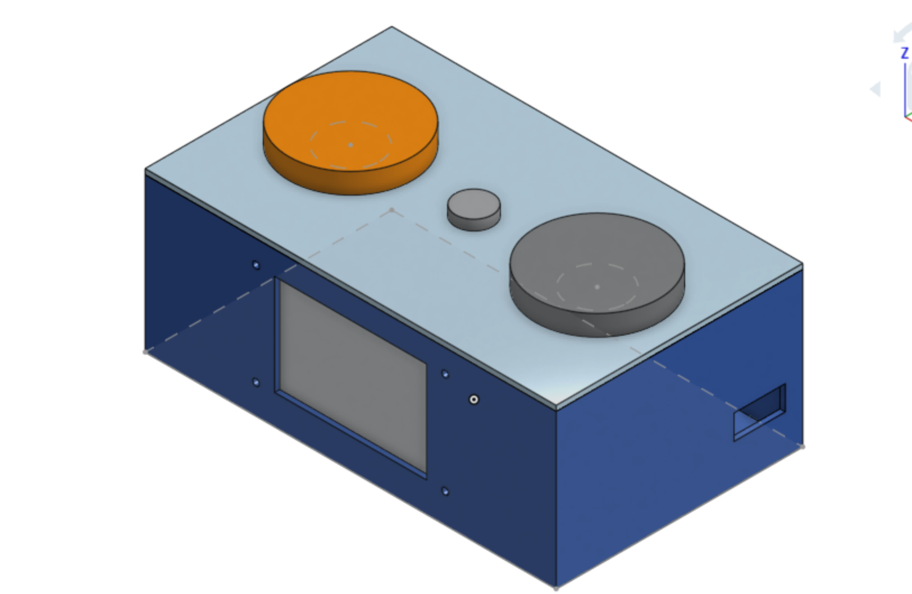
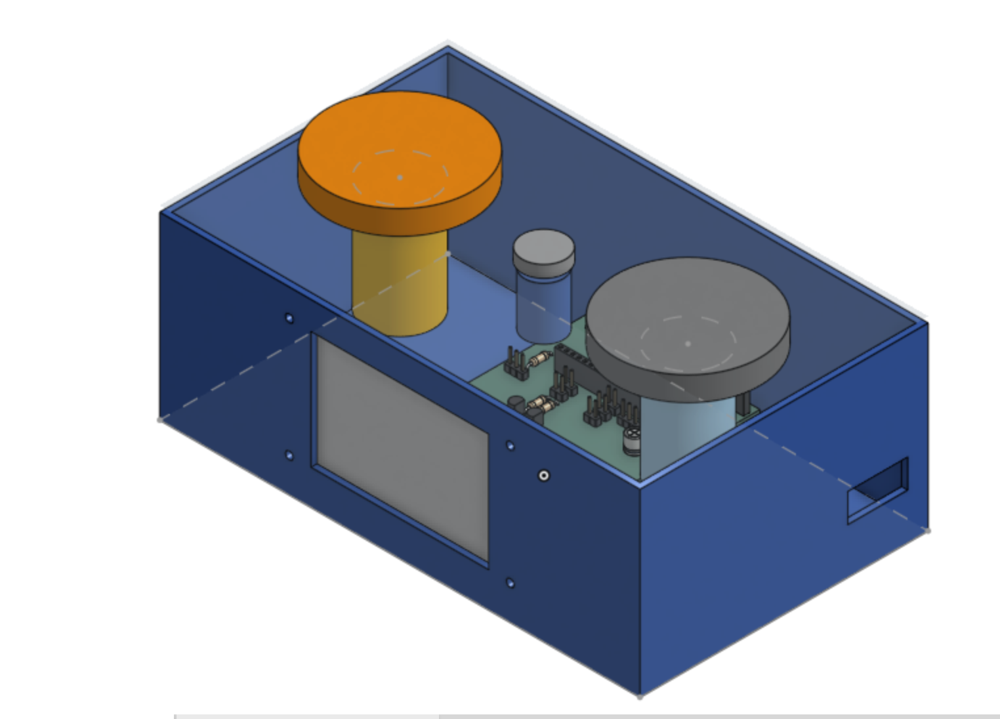
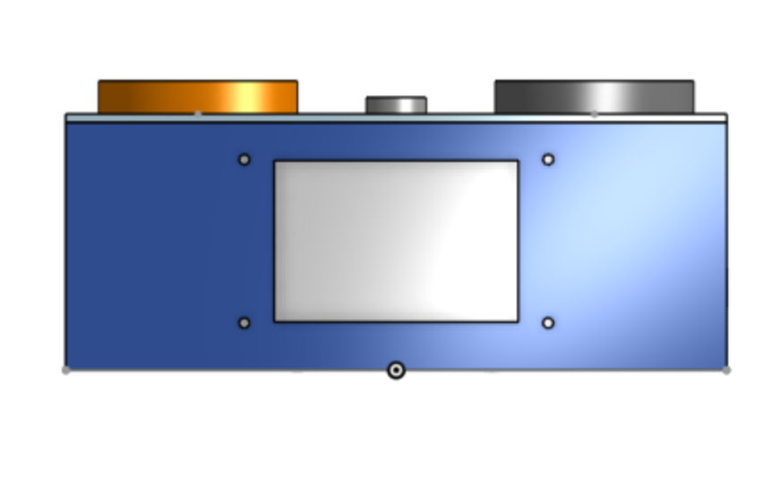

# Mr. Whoami?

A little desk buddy with a face. You chat with it, and you have to figure out one thing:

**Is it a dumb hardcoded script... or an AI *pretending* to be a dumb hardcoded script?**

When you think you know, you slam one of two big buttons: **SCRIPT** or **AI**. Then it reveals the truth.

## 🤔 What even is THIS?
Mr. Whoami? is a lil guy ofc but also a physical version of my earlier project, [Script or AI?](https://github.com/Acookiefor2/script-or-ai). In that one, an AI was the interrogator: it questioned a hidden opponent and tried to guess whether it was a real script or an AI faking one.

This time, **YOU, the human, are the interrogator.**

Every round, Mr. Whoami secretly flips a coin (sneaky):
- **Heads:** you're talking to a real rule-based script.
- **Tails:** you're talking to a small AI model told to act exactly like that script.

You type questions, it answers with a face and little blip sounds, and you try to catch it out.

## 🎮 How a round works
1. Press **START**. The laptop secretly picks script or AI.
2. Type questions on the keyboard for ~90 seconds. Mr. Whoami answers on its screen.
3. Slam **SCRIPT** or **AI**.
4. Reveal!!! The face reacts, the buttons light up, and it plays a win or lose sound.
5. The crowd scoreboard updates (e.g. "humans fooled: 58%").

## 💡 Why build it?
Shenzhen is full of people who are way better at hardware than me. So instead of trying to out-engineer them and trying to beat them at their own game, I'm changing the battle ground by challenging them: **bet you can't tell.**

It's also a real experiment. By the end, I'll have data on how good **humans** are at this compared to the **AI interrogator** from my first project, at the exact same task. (which comparing humans to ai is always fun)

## ⚖️ Keeping it fair
If the script answered instantly and the AI took 2 seconds, anyone and their mother would win in one round. So:
- **Same delay:** every reply waits the same amount of time, shown as a "thinking" face.
- **Same voice:** no text-to-speech. Both modes use the same per-letter blip sounds (Animal Crossing style).
- **Same style:** the AI is prompted to match the script's tone, length and formatting.

## 🧠 How it works

```
 [ Keyboard ] --USB--> [ Mr. Whoami (ESP32-S3) ] <--USB cable--> [ Laptop "brain" ]
                         - 3.5" screen (face + chat)              - game logic
                         - SCRIPT / AI arcade buttons             - rule-based script
                         - START button                           - local AI model (Ollama)
                         - speaker (blips)                        - logging + scoreboard
                         - LED ring (reveal)                      - crowd stats on laptop screen
```

**Minor note: the AI does NOT run on the ESP32.** A microcontroller can't run a language model. Mr. Whoami is the body: face, buttons and sound. The brain is my laptop, running a small local model (Llama 3.2 3B or Qwen 2.5 3B through [Ollama](https://ollama.com)). (hopefully you didn't think that an local llm would run on like under 1 mb raam)

Why local and not a cloud API?
- Most Western AI APIs are blocked in China, so a cloud demo could die on the show floor.
- Expo Wi-Fi could be unreliable. One USB cable carries both power and data, so there's no Wi-Fi involved. 

## 🛠️ Hardware
| Part | What it does |
|---|---|
| ESP32-S3-DevKitC-1 (N16R8) | The microcontroller. Drives the screen, reads buttons and keyboard, plays sounds, talks to the laptop |
| 3.5" SPI TFT display (ST7796, 480x320) | The face on top, the chat underneath |
| 2x 60mm LED arcade buttons | SCRIPT and AI, made for slamming |
| Small push button | START / new round |
| MAX98357A I2S amp + 8Ω speaker | Blip voice and sound effects |
| WS2812B LED ring | Red/green reveal effect |
| Custom carrier PCB | Everything plugs into one board instead of a rat's nest of jumper wires |
| ABS project box | The body, cut and drilled by hand, then decorated |

Full parts list with prices: [`BOM.csv`](./BOM.csv).

### About the PCB
This is my first PCB, so it's deliberately simple: a **carrier board**. The DevKit and the modules plug into headers on it, and it routes the connections between them. No power circuitry, no tiny parts. If the PCB fails, the backup is the same circuit on perfboard.

### Enclosure
I modelled the whole thing in Onshape before buying anything so I could know EXACTLY where every hole goes and well the screen is on the front wall the SCRIPT/AI/START buttons are on the lid and the USB cables come out the right side. The model caught a problem early: the DevKit's USB ports were pointing straight into the back of the screen, so I had to like rotate the board 90° inside the box. (which was scary)

## 📸 Pictures

### Schematic


### PCB


### 3D view



### Enclosure




Onshape model: [open in Onshape](https://cad.onshape.com/documents/b74af73a844940a9566ad19c/w/d542cf5fa6340909a52c948a/e/57c35baeb29c6b37f6020392)

STEP files: [`CAD/Mr.Whoami-enclosure.step`](CAD/Mr.Whoami-enclosure.step) (full box) and [`CAD/Mr.Whoami.step`](CAD/Mr.Whoami.step) (PCB only)

## 📂 Repo structure
* `BOM.csv` - Parts list with prices and links.
* `/schematics` - KiCad schematic, carrier PCB and Gerbers.
* `/CAD` - STEP files for the PCB and the enclosure.
* `/images` - Pictures used in this README.
* `/firmware` - ESP32-S3 code: display, face animations, buttons, keyboard, sound.
* `/brain` - (I'll do this soon) Python on the laptop: script, local model, game logic, logging, scoreboard.

## 🗺️ Plan 
(small change to it)
| When | What |
|---|---|
| Nov 1 - 10 | Schematic, carrier PCB, BOM, enclosure model. Submit the design |
| Nov 11 - 17 | Order parts. Get the laptop brain working (script + local model + game loop) |
| Nov 18 - Dec 1 | Build: wire everything up, firmware, face animations, enclosure |
| Dec 2 - 9 | Playtest with real humans, fix tells, polish |
| Dec 11 | Finished and submitted |

## 🚧 Status
Schematic carrier PCB (DRC clean :D) Gerbers, BOM and the enclosure model are done,next are firmware sketch and then design submission.

## ⚠️ Known risks / open questions
- **Power:** the speaker, LEDs and screen together might pull more than a laptop USB port gives. A separate 5V USB charger is the fallback.
- **Keyboard:** the DevKit's second USB port has to act as a USB host and supply 5V to the keyboard. Still need to confirm the exact setup.
- **Speed:** a 3B model on a laptop CPU should take a few seconds per short reply. The fixed delay hides this, but it still has to be tested.
- **Button depth:** the arcade buttons' depth below the lid isn't listed anywhere on the website when checked so the model assumes 45mm which clears the board and I'll check it when they arrive
